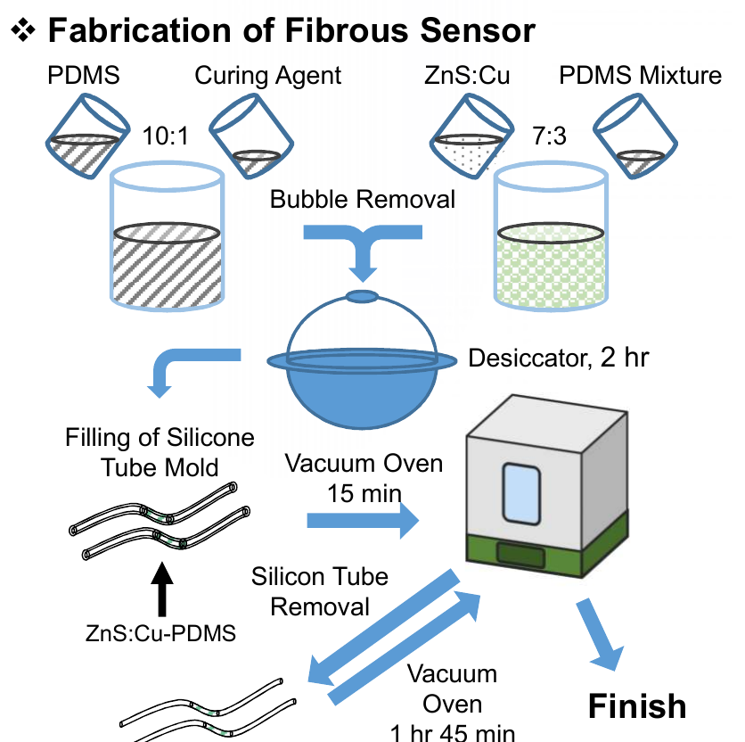
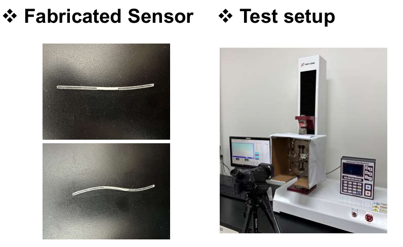
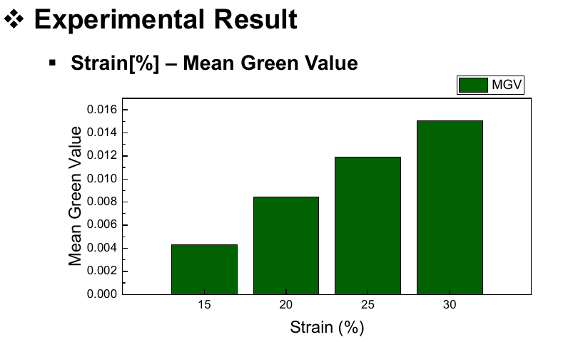

# Fiber-Type Mechanoluminescent Strain Sensor

A flexible fiber-type sensor with a mechanoluminescent section that emits light when the fiber is deformed.
I learned the fabrication method during a research visit to a collaborating laboratory that began in September 2021, then set up the equipment and the process in our lab and trained the lab members who continued the work.
This repository holds a record of the fabrication process, the prototype and its light emission; it contains media only, no code.

  
   
  Light emission each time the fiber is bent, recorded in the dark (levels stretched and playback slowed 2x for visibility).

  
   
  Prototype: a transparent fiber with the mechanoluminescent section in the middle.

## Publications

- D. G. Yuk, D. Ryu, H. S. Kim, J. W. Sohn, "Fabrication of Fiber Type Mechanoluminescent Soft Sensor," AMSM 2022, Georgia Tech, Atlanta, October 26–29, 2022 (poster).
- M. Kim, D.-G. Yuk, D. Ryu, J. W. Sohn, "Mechanical Characteristics Evaluation of Fibrous Mechanoluminescent Sensor," *J. Korean Soc. Manuf. Process Eng.*, 23(9), 1–11, 2024. https://doi.org/10.14775/ksmpe.2024.23.09.001
- M. Kim, D.-G. Yuk, D. Ryu, J. W. Sohn, "Performance Evaluation of Fibrous Sensor Based on Mechanoluminescent Material," PRESM 2023.
- M. Kim, D.-G. Yuk, D. Ryu, J. W. Sohn, "Characteristics Evaluation of Fibrous Mechanoluminescent Sensor," ML & NSHD 2023.

## How the sensor is made

  
   
  Fabrication process, from the AMSM 2022 poster.

| Step | Detail on the poster |
|---|---|
| Base mixture | PDMS and curing agent, 10:1 |
| Mechanoluminescent mixture | ZnS:Cu and the PDMS mixture, 7:3 |
| Bubble removal | desiccator, 2 h |
| Moulding | the ZnS:Cu-PDMS mixture is filled into a silicone tube mould |
| First cure | vacuum oven, 15 min |
| Demoulding | the silicone tube is removed |
| Second cure | vacuum oven, 1 h 45 min |

## Prototype development

The steps below come from my activity record of the research visit; the photos and the clip in this repository date from that period.

| Attempt | Method | Outcome noted in the record |
|---|---|---|
| 1 | Liquid mechanoluminescent mixture placed in a tube filled with PDMS and cured in the oven | the mixture sank under gravity while it cured |
| 2 | Mixture injected into the centre of the fiber with a syringe | the shape of the mixture inside was not uniform |
| 3 | Mixture cured slightly in a thinner silicone tube and then drawn into a tube filled with PDMS | a fiber of the intended form |
| 4 | Thin film: mixture spread between PDMS with glass, cured for 10 min, cut to shape while still tacky, cured for about 2 h more, placed in a 2 mm tube and the rest filled with PDMS | more stable to make than attempts 2 and 3 |

- The sheet-type sensor that I first made during the visit used ZnS:Cu and PDMS at 7:3, degassed in a vacuum desiccator and cured for 2 h in an oven at 80 °C.
- The first light readout was a phototransistor circuit read by an Arduino board, which showed no change when the fiber emitted light.
- A multimeter showed a voltage change of about 0.5 mV, below the 4.9 mV resolution of the Arduino analog input.
- An amplifier stage with a gain of 100 was added, and the change was still not visible after it.
- The record ends with the plan to rebuild the circuit on a soldered board with a different amplifier and to change the joint between the mixture and the PDMS so that more light passes.
- The AMSM 2022 poster measures the emission with a camera instead.

## Test and result

<table>
  <tr>
    <td align="center" width="50%"> Fabricated sensor and the test setup with a tensile tester and a camera, from the AMSM 2022 poster.</td>
    <td align="center" width="50%"> Mean green value of the emitted light at 15, 20, 25 and 30 % strain, from the AMSM 2022 poster.</td>
  </tr>
  <tr>
    <td align="center"> A fiber fixed on a plate for testing (January 2022).</td>
    <td align="center"> Early readout setup with a breadboard circuit and an Arduino board (November 2021).</td>
  </tr>
</table>

- The poster states the objectives as fabricating the fibrous sensor, establishing a measurement method and verifying its use as a strain sensor.
- The poster concludes that the fabricated sensor is flexible and resilient enough for the fiber to serve as a strain sensor, and names soft robotics as future work.

## Repository structure

| Path | Purpose |
|---|---|
| `docs/ml_fiber_glow.gif` | Light emission of the fiber under repeated bending |
| `docs/ml_fiber_prototype.jpg` | Photo of the fiber prototype |
| `docs/poster_fabrication_process.png` | Fabrication process panel of the AMSM 2022 poster |
| `docs/poster_sensor_and_test_setup.png` | Sensor photos and test-setup photo from the poster |
| `docs/poster_strain_response.png` | Result chart from the poster |
| `docs/ml_fiber_fixture.jpg` | Fiber fixed on a plate for testing |
| `docs/ml_readout_setup.jpg` | Early readout setup |

## Notes

- The photos and the clip were recorded between November 2021 and January 2022, and the poster is from October 2022.
- Later test results are in the 2023 and 2024 publications above.
