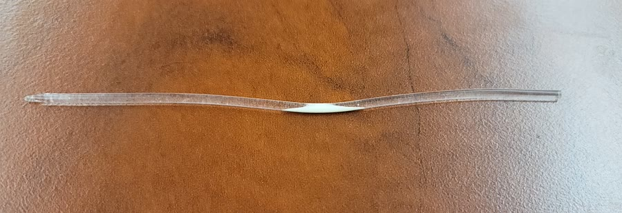
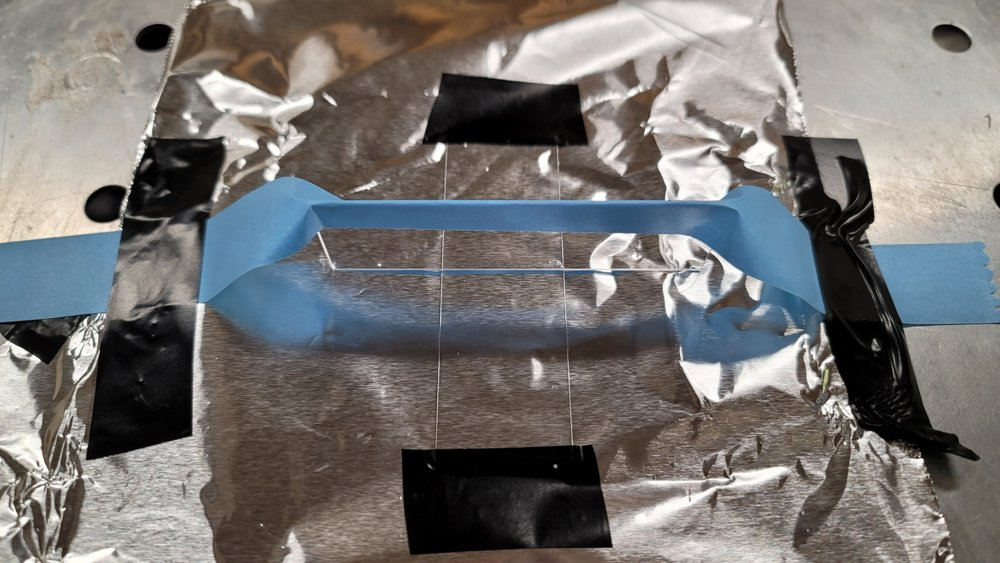
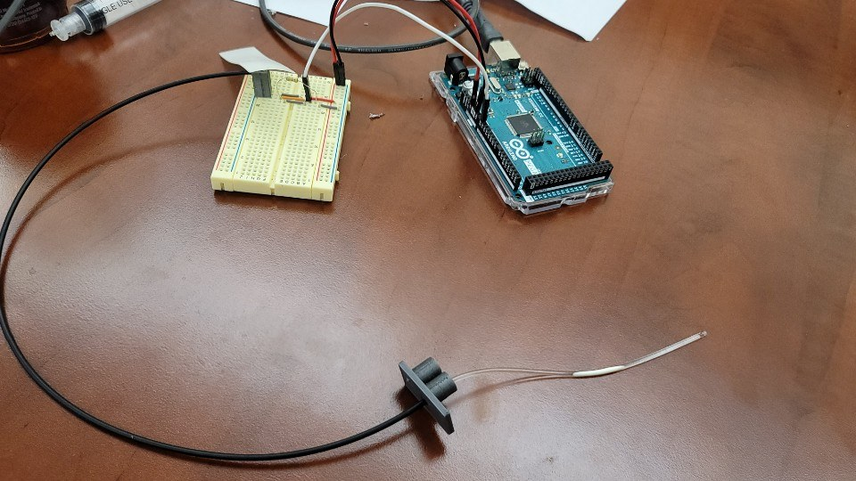

# Fiber-Type Mechanoluminescent Strain Sensor

A flexible fiber-type sensor with a mechanoluminescent section that emits light when the fiber is deformed.
I learned the fabrication method, set up the equipment and the process in our lab, and trained the lab members who continued the work.
This repository holds a short record of the prototype and its light emission; it contains media only, no code.

  
   
  Light emission each time the fiber is bent, recorded in the dark (levels stretched and playback slowed 2x for visibility).

  
   
  Prototype: a transparent fiber with the mechanoluminescent section in the middle.

<table>
  <tr>
    <td align="center" width="50%"> A fiber fixed on a plate for testing (January 2022).</td>
    <td align="center" width="50%"> Early readout setup with a breadboard circuit and an Arduino board (November 2021).</td>
  </tr>
</table>

## Publications

- M. Kim, D.-G. Yuk, D. Ryu, J. W. Sohn, "Mechanical Characteristics Evaluation of Fibrous Mechanoluminescent Sensor," *J. Korean Soc. Manuf. Process Eng.*, 23(9), 1–11, 2024. https://doi.org/10.14775/ksmpe.2024.23.09.001
- D.-G. Yuk, D. Ryu, J. W. Sohn, "Fabrication of Fiber Type Mechanoluminescent Soft Sensor," AMSM 2022.
- M. Kim, D.-G. Yuk, D. Ryu, J. W. Sohn, "Performance Evaluation of Fibrous Sensor Based on Mechanoluminescent Material," PRESM 2023.
- M. Kim, D.-G. Yuk, D. Ryu, J. W. Sohn, "Characteristics Evaluation of Fibrous Mechanoluminescent Sensor," ML & NSHD 2023.

## Repository structure

| Path | Purpose |
|---|---|
| `docs/ml_fiber_glow.gif` | Light emission of the fiber under repeated bending |
| `docs/ml_fiber_prototype.jpg` | Photo of the fiber prototype |
| `docs/ml_fiber_fixture.jpg` | Fiber fixed on a plate for testing |
| `docs/ml_readout_setup.jpg` | Early readout setup |

## Notes

- The media were recorded between November 2021 and January 2022.
- Fabrication details and test results are in the publications above.
